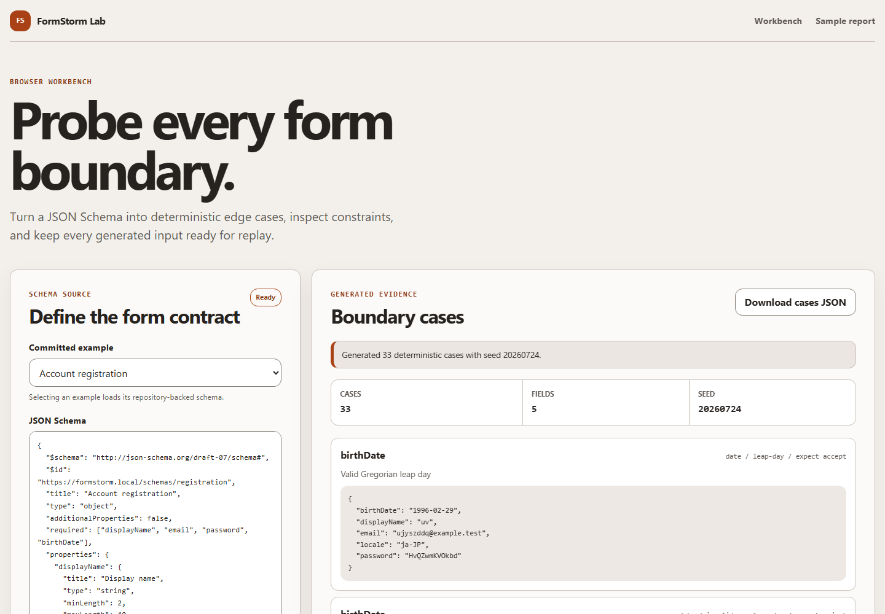

# FormStorm Lab

[](https://github.com/KanadeK/formstorm-lab/actions/workflows/ci.yml)
[](https://github.com/KanadeK/formstorm-lab/releases)
[](LICENSE)

[简体中文](README.zh-CN.md)

FormStorm Lab turns a JSON Schema and its real HTML form into deterministic boundary, internationalization, accessibility, and validation checks. It runs the probes in Chromium, distinguishes expected business rejection from a browser failure, and saves evidence that another developer can replay.

Current package version: `v0.1.0`.



- Generate seeded length, Unicode, right-to-left, whitespace, date, filename, email, number, and select cases.
- Compare schema constraints with the live DOM and run axe-core in a real browser.
- Keep reviewable evidence: JSON, standalone HTML, JUnit XML, screenshot, trace, minimal failing input, and a replay command.

## Quick start

Node.js 22 or newer is required. The bundled demo is offline after dependencies and Chromium have been installed.

```bash
git clone https://github.com/KanadeK/formstorm-lab.git
cd formstorm-lab
npm ci
npx playwright install chromium
npm run demo
```

Open `reports/demo/summary.json`, then open any fixture's `report.html`, `scan.png`, or `trace.zip`. The demo scans registration, checkout, and multilingual profile fixtures and fails if a fixture does not expose its seeded validation and accessibility problems.

## Input to output

Given this field from `fixtures/registration/schema.json`:

```json
{
  "username": {
    "type": "string",
    "title": "Username",
    "minLength": 3,
    "maxLength": 12,
    "pattern": "^[A-Za-z0-9]+$"
  }
}
```

`extract` produces a typed field with constraint provenance. This is an excerpt of the real output shape:

```json
{
  "id": "username",
  "name": "username",
  "label": "Username",
  "kind": "text",
  "required": true,
  "constraints": {
    "minLength": 3,
    "maxLength": 12,
    "pattern": "^[A-Za-z0-9]+$"
  },
  "provenance": [
    {
      "constraint": "required",
      "origin": "json-schema",
      "sourcePath": "#/required",
      "keyword": "required"
    }
  ]
}
```

When `scan` opens the registration fixture, it also extracts the HTML controls and finds that the DOM uses `minlength="4"`. The report records that schema to DOM mismatch, axe-core findings, generated boundary outcomes, the smallest retained failing assignment, and the command used to reproduce it.

## Features

### Schema and page inspection

- Reads a local JSON Schema file and validates its structure before use.
- Extracts labels, types, required state, limits, patterns, formats, options, defaults, examples, and the source of each constraint.
- Resolves non-recursive local JSON Pointer references.
- Extracts native `input`, `select`, and `textarea` controls from a real page.
- Compares the schema with DOM constraints and reports concrete disagreements.

### Deterministic boundary generation

- Uses a fixed unsigned 32-bit seed through Faker.
- Covers below, at, and above length or numeric boundaries where constraints exist.
- Covers combining characters, emoji, Arabic, Hebrew, ASCII-only and mixed whitespace, leap dates, malformed dates, Unicode filenames, long filenames, and path-like filenames.
- Uses the schema oracle to label each case as expected acceptance, expected rejection, or observation.

### Browser execution and evidence

- Runs Chromium through Playwright with service workers disabled.
- Runs axe-core against the loaded page.
- Executes fixture business cases and boundary cases without turning expected rejection into a runtime error.
- Attempts failure minimization with a bounded number of probes.
- Writes deterministic machine-readable reports and human review artifacts.

## Safety model

The CLI has no implicit live target. `scan` requires one or more exact HTTP or HTTPS origins through `--allow-origin`, and the target's normalized origin must be present. Every redirect and subresource request is checked. Requests to another origin and all non-GET, non-HEAD, and non-OPTIONS HTTP requests are blocked.

An allowlist is a technical guard, not authorization. Only test systems that you own or have permission to assess. Screenshots, traces, DOM snippets, URLs, and browser messages can still contain page data. FormStorm Lab redacts sensitive key names and common token patterns in serialized reports, but you must review every artifact before sharing it.

See [Privacy and security](docs/PRIVACY_AND_SECURITY.md) for the full trust boundary.

## Installation

### Work from source

```bash
npm ci
npx playwright install chromium
npm run build
node dist/node/cli.js --help
```

### Install a release tarball

Download `formstorm-lab-0.1.0-node-any.tgz` from the GitHub release, verify it with `SHA256SUMS.txt`, then install it:

```bash
npm install --global ./formstorm-lab-0.1.0-node-any.tgz
formstorm --version
```

The Node package does not bundle a Chromium binary. Install the matching browser once with `npx playwright install chromium` before using `scan`, `replay`, or `demo`.

## CLI

Build the Node entry point first when working from a clone:

```bash
npm run build:node
```

### Extract

Extract fields and provenance without launching a browser:

```bash
node dist/node/cli.js extract --schema fixtures/registration/schema.json --out reports/registration-model.json
```

To extract native controls from an allowlisted page, serve the fixture and pass
an exact origin:

```bash
node dist/node/cli.js extract --target http://127.0.0.1:4174/registration/index.html --allow-origin http://127.0.0.1:4174 --out reports/registration-dom.json
```

### Generate

Generate cases locally. Omit `--dimensions` to use every applicable dimension.

```bash
node dist/node/cli.js generate --schema fixtures/multilingual-profile/schema.json --seed 4501 --dimensions length,unicode,rtl,whitespace,date,filename --out reports/profile-cases.json
```

Supported dimension names are `length`, `unicode`, `rtl`, `whitespace`, `date`, `filename`, `email`, `number`, and `select`.

### Scan

Serve the committed fixtures in one terminal:

```bash
npx vite fixtures --host 127.0.0.1 --port 4174 --strictPort
```

Run the browser scan in another terminal. The allowlist value is an exact origin, with no path:

```bash
node dist/node/cli.js scan --schema fixtures/registration/schema.json --profile fixtures/registration/profile.json --target http://127.0.0.1:4174/registration/index.html --allow-origin http://127.0.0.1:4174 --seed 4501 --out reports/registration
```

For schemas inside a fixture directory, `scan` automatically uses a sibling `profile.json` when one exists. Pass `--profile` to make that choice explicit.

### Replay

Replay from the portable schema copy, target, exact allowlist, and seed stored
with the JSON report. Fixture reports can restart their loopback server even
after the original server has closed:

```bash
node dist/node/cli.js replay --report reports/registration/report.json --out reports/registration-replay
```

### Demo

`demo` starts the deterministic fixture server, scans all three fixture applications, checks their seeded findings, then closes the server:

```bash
node dist/node/cli.js demo --seed 4501 --out reports/demo
```

The repository task `npm run demo` builds the project before invoking this command.

## Report artifacts

Each browser scan writes:

| File                | Purpose                                             |
| ------------------- | --------------------------------------------------- |
| `report.json`       | Complete scan data for automation and replay        |
| `input.schema.json` | Portable copy of the schema used for the scan       |
| `report.html`       | Standalone, redacted human review                   |
| `report.junit.xml`  | CI test reporting                                   |
| `scan.png`          | Final page state                                    |
| `trace.zip`         | Playwright screenshots, snapshots, and source trace |

The JSON report includes the normalized allowlist, fixed seed, target, extracted forms, schema to DOM findings, axe-core findings, business outcomes, boundary classifications, expected rejection count, minimal inputs for failures where minimization applies, security blocks, and replay commands.

## JavaScript API

The package root exports the browser-independent domain core:

```ts
import { createSchemaOracle, extractFormModel, generateBoundaryCases } from "formstorm-lab";

const schema = {
  type: "object",
  required: ["displayName"],
  properties: {
    displayName: { type: "string", minLength: 1, maxLength: 40 },
  },
};

const extraction = extractFormModel(schema, { unsupported: "diagnostic" });
const cases = generateBoundaryCases(extraction.form, {
  seed: 4501,
  dimensions: ["length", "unicode", "rtl", "whitespace"],
  oracle: createSchemaOracle(schema),
});
```

The exported functions do not read files, open a browser, or use the network. Browser execution is intentionally exposed through the CLI in `v0.1.0`.

## Web workbench

Run the local interface with:

```bash
npm run dev:web
```

The workbench can load a bundled example or a local JSON file, display extracted constraints, generate seeded cases in the browser, download the generated JSON, and filter a committed sample report. The static Pages build does not run Playwright and cannot scan a live URL. That separation keeps the public demo free of credentials and user-supplied browsing.

## Offline fixtures

All fixture HTML, scripts, schemas, and profiles are original synthetic data under this repository's MIT license. No external API is required.

| Fixture              | Declared fields | Seeded validation disagreement                         | Seeded accessibility problem         |
| -------------------- | --------------: | ------------------------------------------------------ | ------------------------------------ |
| Registration         |               3 | Schema username minimum is 3, DOM minimum is 4         | Submit button has no accessible name |
| Checkout             |               3 | Schema postal code length is 5, DOM pattern requires 6 | Submit button has no accessible name |
| Multilingual profile |               5 | Schema display name maximum is 40, DOM maximum is 24   | Submit button has no accessible name |

Each profile also includes one expected business rejection. These are classified as expected rejection when the displayed result matches the fixture profile, not as an application crash.

## Supported schema scope

`v0.1.0` supports a JSON Schema object with direct scalar properties:

- String, number, integer, boolean, enum, and const fields.
- Email, date, and binary string formats.
- Required, length, pattern, numeric, date range, default, and examples constraints.
- Local, non-recursive JSON Pointer references.

Nested objects, arrays, schema composition and conditionals, recursive references, external references, and remote schema loading are outside this release's scope. Unsupported fields can be reported as diagnostics where the caller selects diagnostic mode.

## Non-goals

- A production crawler, load tester, exploit framework, or replacement for an authorization process.
- Automatic submission of real transactions or mutation of remote systems.
- A full JSON Schema implementation.
- Browser automation inside the static Pages workbench.
- A guarantee that automatically generated cases cover product-specific business rules without a fixture profile.

## Architecture

```text
JSON Schema ----> domain core ----> seeded cases ----> schema oracle
      |                |
      |                +----> extraction diagnostics and provenance
      |
HTML form ------> Playwright adapter ----> DOM comparison + axe-core
                         |
                         +----> outcome classification + minimization
                                      |
                                      +----> JSON / HTML / JUnit / image / trace
```

`src/core` is deterministic and browser-independent. `src/adapters` owns local files, fixture serving, DOM inspection, the request policy, browser execution, and artifact storage. `src/reporters` handles serialization and redaction. `src/commands` connects those pieces to the CLI. `src/web` reuses only the browser-safe core.

See [Architecture](docs/ARCHITECTURE.md) for data contracts, failure semantics, and extension guidance.

## Testing and quality gates

Install Chromium before the first full run:

```bash
npm ci
npx playwright install chromium
npm run lint
npm run typecheck
npm run test:coverage
npm run test:e2e
npm run build
npm run package
```

The equivalent repository gates are:

```bash
make verify
make demo
make package
make release-check
```

On systems without Make, use `npm run verify`, `npm run demo`, `npm run package`, and `npm run release-check`. Unit tests cover the domain core, integration tests use real files and the local fixture server, and end-to-end tests exercise keyboard generation, JSON download, narrow viewports, and automated accessibility checks. Random inputs use fixed seeds and browser times can be injected for stable reports.

The release package task builds and scans the fixtures, runs end-to-end tests, creates the npm tarball and ZIP assets, installs the tarball in a clean temporary directory, runs its version command, and writes `dist-release/SHA256SUMS.txt`.

See [Benchmark protocol](docs/BENCHMARK.md) for the reproducible sample workload.

## Competitive context

A pre-build sample of public repositories found no active project with the same name and the same combined workflow. Adjacent tools tend to focus on schema-based API fuzzing, browser accessibility audits, or form input generation separately. FormStorm Lab's narrower distinction is the combination of schema provenance, live DOM mismatch detection, deterministic internationalized cases, expected rejection classification, exact-origin request policy, minimization, and replayable browser evidence.

This is a sampled comparison, not a uniqueness claim. The repositories and scoring method are recorded in [Competitive scan](docs/COMPETITOR_SCAN.md).

## Roadmap

- Broaden schema coverage with nested and composed structures while retaining explicit diagnostics.
- Add opt-in Firefox and WebKit verification after artifact parity is established.
- Make fixture profiles more expressive for product-specific outcomes and stable selectors.
- Publish a versioned report schema and migration notes as the format evolves.
- Improve case reduction across dependent fields without weakening the request policy.

No roadmap item changes the `v0.1.0` deny-by-default network behavior.

## Contributing

Issues and focused pull requests are welcome. Behavior changes need a test that would fail without the change. New fixtures must be synthetic, deterministic, license-clear, and must not call an external service. Run `npm run verify` before opening a pull request.

Read [Contributing](CONTRIBUTING.md), the [Code of Conduct](CODE_OF_CONDUCT.md), and [Security Policy](SECURITY.md) before participating.

## FAQ

### Does adding an origin grant permission to test it?

No. The allowlist only prevents accidental origin drift. Legal and organizational authorization remains your responsibility.

### Why did my form submission not reach its server?

The browser policy blocks POST, PUT, PATCH, DELETE, and every other state-changing HTTP method. Local fixture forms handle their synthetic outcomes in the page, so the demo does not require a network mutation.

### Why was a rejected value not reported as a crash?

The schema oracle assigns an expectation before execution. A native or fixture business rejection that matches an expected rejection is tracked separately. JavaScript page errors and execution failures are runtime findings.

### Can the Pages site scan my application?

No. Pages provides a browser-only schema workbench and a synthetic report viewer. Use the local CLI for Playwright execution.

### Is the same seed sufficient for byte-identical reports?

The seed makes generated values and case order reproducible. Browser version, axe-core version, operating system messages, absolute paths, generated timestamp, and execution duration can still vary. Use the lockfile and Node.js 22 for release comparisons.

### What should I attach to a bug report?

Include the version, operating system, Node and Chromium versions, fixed seed, schema or synthetic reduction, redacted `report.json`, and the smallest replay command that demonstrates the problem. Do not attach production credentials or private traces.

## License

[MIT](LICENSE)
