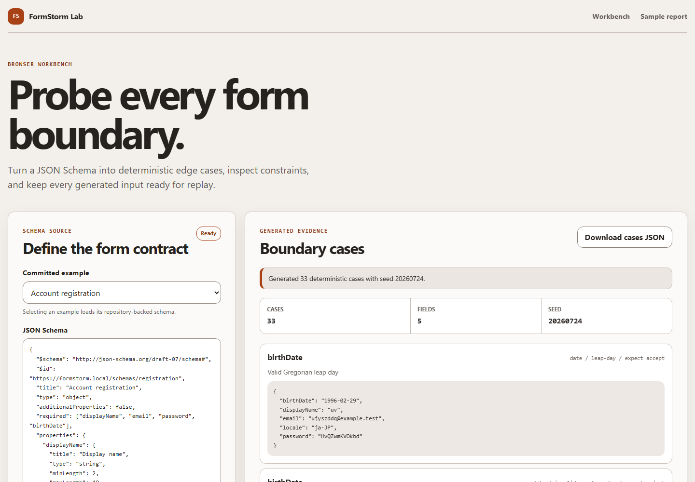

# FormStorm Lab

[](https://github.com/KanadeK/formstorm-lab/actions/workflows/ci.yml)
[](https://github.com/KanadeK/formstorm-lab/releases)
[](LICENSE)

[English](README.md)

FormStorm Lab 把 JSON Schema 与真实 HTML 表单转换为可复现的边界、国际化、无障碍和验证检查。它在 Chromium 中执行探测，区分预期的业务拒绝与浏览器故障，并保存可由另一位开发者重放的证据。

当前包版本：`v0.1.0`。



- 用固定 seed 生成长度、Unicode、从右向左文本、空白、日期、文件名、邮箱、数字和选项边界。
- 比较 schema 与实时 DOM 约束，并在真实浏览器中运行 axe-core。
- 保存可审查证据：JSON、独立 HTML、JUnit XML、截图、trace、最小失败输入和重放命令。

## 快速开始

需要 Node.js 22 或更高版本。依赖与 Chromium 安装完成后，随仓库提供的演示可离线运行。

```bash
git clone https://github.com/KanadeK/formstorm-lab.git
cd formstorm-lab
npm ci
npx playwright install chromium
npm run demo
```

先打开 `reports/demo/summary.json`，再查看任意 fixture 的 `report.html`、`scan.png` 或 `trace.zip`。演示会扫描注册、结账和多语言资料三个 fixture。如果某个 fixture 没有暴露预置的验证与无障碍问题，命令会失败。

## 从输入到输出

`fixtures/registration/schema.json` 中包含以下字段：

```json
{
  "username": {
    "type": "string",
    "title": "Username",
    "minLength": 3,
    "maxLength": 12,
    "pattern": "^[A-Za-z0-9]+$"
  }
}
```

`extract` 会得到带约束来源的类型化字段。下面是实际输出结构的节选：

```json
{
  "id": "username",
  "name": "username",
  "label": "Username",
  "kind": "text",
  "required": true,
  "constraints": {
    "minLength": 3,
    "maxLength": 12,
    "pattern": "^[A-Za-z0-9]+$"
  },
  "provenance": [
    {
      "constraint": "required",
      "origin": "json-schema",
      "sourcePath": "#/required",
      "keyword": "required"
    }
  ]
}
```

`scan` 打开注册 fixture 时还会提取 HTML 控件，并发现 DOM 使用 `minlength="4"`。报告会记录 schema 与 DOM 的差异、axe-core 问题、边界用例结果、保留下来的最小失败赋值以及复现命令。

## 功能

### Schema 与页面检查

- 读取本地 JSON Schema 文件，使用前验证其结构。
- 提取标签、类型、必填状态、限制、正则、格式、选项、默认值、示例与每项约束的来源。
- 解析非递归的本地 JSON Pointer 引用。
- 从真实页面提取原生 `input`、`select` 和 `textarea` 控件。
- 比较 schema 与 DOM 约束，并报告具体差异。

### 可复现的边界生成

- 通过 Faker 使用固定的 32 位无符号 seed。
- 对已有约束生成小于、等于和大于长度或数字边界的用例。
- 覆盖组合字符、emoji、阿拉伯文、希伯来文、纯 ASCII 空白、混合空白、闰日、无效日期、Unicode 文件名、长文件名和类路径文件名。
- 用 schema oracle 在执行前把用例标记为预期接受、预期拒绝或仅观察。

### 浏览器执行与证据

- 通过 Playwright 运行 Chromium，并禁用 service worker。
- 对已加载页面运行 axe-core。
- 执行 fixture 业务用例与边界用例，不把预期业务拒绝当成运行时错误。
- 在限定尝试次数内缩减失败输入。
- 输出稳定的机器可读报告与人工审查文件。

## 安全模型

CLI 不包含隐式在线目标。`scan` 必须通过 `--allow-origin` 提供一个或多个精确 HTTP 或 HTTPS origin，目标规范化后的 origin 必须位于其中。每次跳转和子资源请求都会经过策略检查。不同 origin 的请求，以及除 GET、HEAD、OPTIONS 之外的 HTTP 请求都会被阻止。

Allowlist 是技术护栏，不代表测试授权。只能测试你拥有或获准评估的系统。截图、trace、DOM 片段、URL 和浏览器消息仍可能包含页面数据。FormStorm Lab 会在序列化报告中遮盖敏感键名和常见 token 模式，但分享任何制品前仍必须人工检查。

完整边界见[隐私与安全](docs/PRIVACY_AND_SECURITY.md)。

## 安装

### 从源码运行

```bash
npm ci
npx playwright install chromium
npm run build
node dist/node/cli.js --help
```

### 安装 Release tarball

从 GitHub Release 下载 `formstorm-lab-0.1.0-node-any.tgz`，用 `SHA256SUMS.txt` 校验后安装：

```bash
npm install --global ./formstorm-lab-0.1.0-node-any.tgz
formstorm --version
```

Node 包不内置 Chromium 二进制。在使用 `scan`、`replay` 或 `demo` 前，运行一次 `npx playwright install chromium`。

## CLI

在源码仓库中先构建 Node 入口：

```bash
npm run build:node
```

### Extract

不启动浏览器，提取字段与约束来源：

```bash
node dist/node/cli.js extract --schema fixtures/registration/schema.json --out reports/registration-model.json
```

若要从 allowlist 允许的页面提取原生控件，请先启动 fixture，并传入精确 origin：

```bash
node dist/node/cli.js extract --target http://127.0.0.1:4174/registration/index.html --allow-origin http://127.0.0.1:4174 --out reports/registration-dom.json
```

### Generate

在本地生成用例。不传 `--dimensions` 时使用对字段适用的所有维度。

```bash
node dist/node/cli.js generate --schema fixtures/multilingual-profile/schema.json --seed 4501 --dimensions length,unicode,rtl,whitespace,date,filename --out reports/profile-cases.json
```

支持的维度名称为 `length`、`unicode`、`rtl`、`whitespace`、`date`、`filename`、`email`、`number` 和 `select`。

### Scan

在一个终端中启动随仓库提交的 fixture：

```bash
npx vite fixtures --host 127.0.0.1 --port 4174 --strictPort
```

在另一个终端中运行浏览器扫描。Allowlist 值必须是没有路径的精确 origin：

```bash
node dist/node/cli.js scan --schema fixtures/registration/schema.json --profile fixtures/registration/profile.json --target http://127.0.0.1:4174/registration/index.html --allow-origin http://127.0.0.1:4174 --seed 4501 --out reports/registration
```

如果 schema 所在目录含有相邻的 `profile.json`，`scan` 会自动读取它。传入 `--profile` 可以明确指定。

### Replay

使用报告旁的可移植 schema 副本，以及 JSON 报告保存的目标、精确 allowlist 和 seed 重放扫描。即使原 fixture server 已关闭，fixture 报告也能重新启动本地服务：

```bash
node dist/node/cli.js replay --report reports/registration/report.json --out reports/registration-replay
```

### Demo

`demo` 会启动确定性的 fixture server，扫描三个 fixture，检查预置问题，然后关闭服务器：

```bash
node dist/node/cli.js demo --seed 4501 --out reports/demo
```

仓库任务 `npm run demo` 会先构建项目，再调用此命令。

## 报告制品

每次浏览器扫描都会写入：

| 文件                | 用途                              |
| ------------------- | --------------------------------- |
| `report.json`       | 用于自动化与重放的完整扫描数据    |
| `input.schema.json` | 扫描所用 schema 的可移植副本      |
| `report.html`       | 已遮盖敏感值的独立人工审查页面    |
| `report.junit.xml`  | CI 测试报告                       |
| `scan.png`          | 最终页面状态                      |
| `trace.zip`         | Playwright 截图、快照和源码 trace |

JSON 报告包括规范化 allowlist、固定 seed、目标、已提取表单、schema 与 DOM 的差异、axe-core 问题、业务结果、边界分类、预期拒绝数、适用情况下的最小失败输入、安全阻止事件和重放命令。

## JavaScript API

包根入口导出不依赖浏览器的领域核心：

```ts
import { createSchemaOracle, extractFormModel, generateBoundaryCases } from "formstorm-lab";

const schema = {
  type: "object",
  required: ["displayName"],
  properties: {
    displayName: { type: "string", minLength: 1, maxLength: 40 },
  },
};

const extraction = extractFormModel(schema, { unsupported: "diagnostic" });
const cases = generateBoundaryCases(extraction.form, {
  seed: 4501,
  dimensions: ["length", "unicode", "rtl", "whitespace"],
  oracle: createSchemaOracle(schema),
});
```

这些导出函数不会读取文件、打开浏览器或使用网络。`v0.1.0` 的浏览器执行通过 CLI 提供。

## Web 工作台

运行本地界面：

```bash
npm run dev:web
```

工作台可以加载内置样例或本地 JSON 文件，展示提取的约束，在浏览器中生成固定 seed 的用例，下载生成的 JSON，并筛选随项目提交的样例报告。静态 Pages 版本不会运行 Playwright，也不能扫描在线 URL。这样可以避免公共演示接触凭证或用户指定的页面。

## 离线 fixture

全部 fixture HTML、脚本、schema 与 profile 都是使用仓库 MIT 许可证发布的原创合成数据，不依赖外部 API。

| Fixture    | 声明字段数 | 预置验证差异                          | 预置无障碍问题         |
| ---------- | ---------: | ------------------------------------- | ---------------------- |
| 注册       |          3 | Schema 用户名最小长度为 3，DOM 为 4   | 提交按钮没有无障碍名称 |
| 结账       |          3 | Schema 邮编长度为 5，DOM 正则要求 6   | 提交按钮没有无障碍名称 |
| 多语言资料 |          5 | Schema 显示名最大长度为 40，DOM 为 24 | 提交按钮没有无障碍名称 |

每个 profile 还包含一个预期业务拒绝。当页面结果符合 profile 声明时，它会被分类为预期拒绝，而不是应用崩溃。

## 支持的 schema 范围

`v0.1.0` 支持根为 JSON Schema object，且直接属性为标量字段：

- 字符串、数字、整数、布尔、enum 和 const 字段。
- Email、date 和 binary 字符串格式。
- Required、长度、正则、数字、日期范围、默认值与示例约束。
- 非递归的本地 JSON Pointer 引用。

嵌套对象、数组、组合与条件 schema、递归引用、外部引用和远程 schema 加载不属于本版本范围。当调用方选择 diagnostic 模式时，不支持的字段可以转为明确诊断。

## 非目标

- 生产爬虫、压力测试器、漏洞利用框架或授权流程的替代品。
- 自动提交真实交易或修改远程系统。
- 完整实现全部 JSON Schema 标准。
- 在静态 Pages 工作台中运行浏览器自动化。
- 在没有 fixture profile 的情况下保证自动生成用例覆盖产品特有业务规则。

## 架构

```text
JSON Schema ----> 领域核心 ----> 固定 seed 用例 ----> schema oracle
      |                |
      |                +----> 提取诊断与约束来源
      |
HTML 表单 ------> Playwright 适配器 ----> DOM 比较 + axe-core
                         |
                         +----> 结果分类 + 失败缩减
                                      |
                                      +----> JSON / HTML / JUnit / 图片 / trace
```

`src/core` 是可复现且不依赖浏览器的领域层。`src/adapters` 负责本地文件、fixture server、DOM 检查、请求策略、浏览器执行与制品存储。`src/reporters` 负责序列化和敏感值遮盖。`src/commands` 把这些模块连接到 CLI。`src/web` 只复用浏览器安全的核心。

数据契约、失败语义与扩展方式见[架构说明](docs/ARCHITECTURE.md)。

## 测试与质量门

首次完整运行前安装 Chromium：

```bash
npm ci
npx playwright install chromium
npm run lint
npm run typecheck
npm run test:coverage
npm run test:e2e
npm run build
npm run package
```

等价的仓库质量门为：

```bash
make verify
make demo
make package
make release-check
```

系统没有 Make 时，使用 `npm run verify`、`npm run demo`、`npm run package` 和 `npm run release-check`。单元测试覆盖领域核心，集成测试使用真实文件和本地 fixture server，端到端测试覆盖键盘生成、JSON 下载、窄屏布局和自动无障碍检查。随机输入使用固定 seed，浏览器报告时间可注入。

Release 打包任务会构建并扫描 fixture，执行端到端测试，创建 npm tarball 和 ZIP，进入干净临时目录安装 tarball 并运行版本命令，最后写入 `dist-release/SHA256SUMS.txt`。

可复现样例负载见[性能基准协议](docs/BENCHMARK.md)。

## 竞品差异

开发前对公开仓库进行的抽样检索没有发现同名且使用相同组合流程的活跃项目。相邻工具通常分别聚焦 schema API fuzzing、浏览器无障碍审计或表单输入生成。FormStorm Lab 更窄且明确的差异，是把 schema 约束来源、实时 DOM 差异、可复现国际化用例、预期拒绝分类、精确 origin 请求策略、失败缩减和可重放浏览器证据连为一体。

这是抽样比较，不是唯一性承诺。仓库清单与评分方法见[竞品扫描](docs/COMPETITOR_SCAN.md)。

## 路线图

- 扩展嵌套与组合 schema 支持，同时保留明确诊断。
- 在制品一致性建立后，加入可选 Firefox 与 WebKit 验证。
- 增强 fixture profile 对产品业务结果和稳定 selector 的描述能力。
- 随报告格式演进，发布带版本的 report schema 与迁移说明。
- 在不削弱请求策略的前提下，改进依赖字段之间的用例缩减。

任何路线图事项都不会改变 `v0.1.0` 默认拒绝网络变更的行为。

## 贡献

欢迎提交 Issue 和范围清晰的 Pull Request。行为修改必须包含一个在修改前会失败的测试。新增 fixture 必须是合成、可复现、许可证清晰的数据，且不得调用外部服务。发起 Pull Request 前运行 `npm run verify`。

参与前请阅读[贡献指南](CONTRIBUTING.md)、[行为准则](CODE_OF_CONDUCT.md)和[安全策略](SECURITY.md)。

## 常见问题

### 把 origin 加入 allowlist 就代表有权测试吗？

不是。Allowlist 只能防止目标意外漂移，法律和组织授权仍由使用者负责。

### 为什么表单提交没有到达服务器？

浏览器策略会阻止 POST、PUT、PATCH、DELETE 以及其他会改变状态的 HTTP 方法。本地 fixture 在页面内部处理合成结果，因此演示不需要网络写入。

### 为什么被拒绝的值没有报告为崩溃？

Schema oracle 会在执行前分配预期。如果原生验证或 fixture 业务拒绝符合预期，就会单独记录为预期拒绝。页面 JavaScript 错误和执行失败才是 runtime finding。

### Pages 站点能扫描我的应用吗？

不能。Pages 只提供浏览器内 schema 工作台与合成报告查看器。Playwright 执行需要使用本地 CLI。

### 相同 seed 能生成字节完全一致的报告吗？

Seed 会固定生成值与用例顺序。浏览器版本、axe-core 版本、操作系统验证消息、绝对路径、生成时间和执行耗时仍可能变化。发布对比应使用 lockfile 与 Node.js 22。

### 报告 Bug 时应附带什么？

请提供版本、操作系统、Node 与 Chromium 版本、固定 seed、schema 或合成缩减样例、已遮盖的 `report.json`，以及能复现问题的最小命令。不要附带生产凭证或私有 trace。

## 许可证

[MIT](LICENSE)
